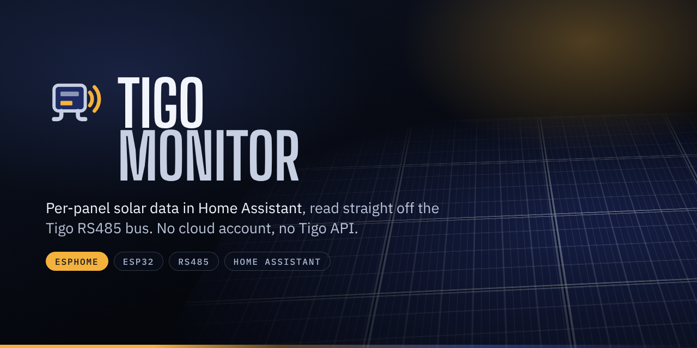
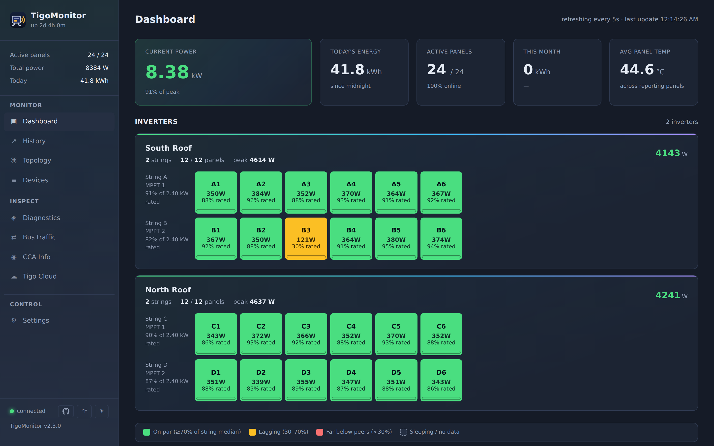
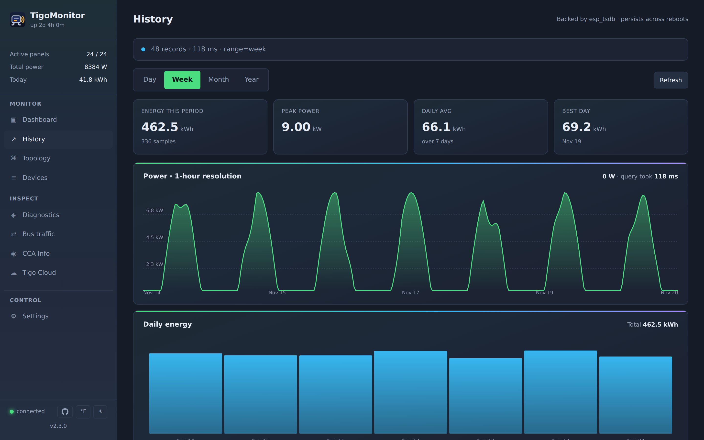
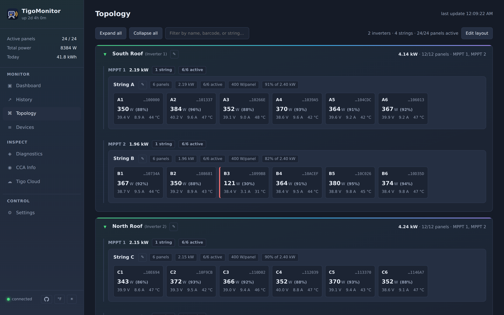

# TigoMonitor

Each Tigo optimizer's power, voltage and temperature, read from the RS485 bus
by a USB adapter or a network bridge, in Home Assistant's sidebar and over
MQTT.

![Supports aarch64][aarch64-shield] ![Supports amd64][amd64-shield]

## What it does

- **Every optimizer on its own.** Power, voltage and current in and out,
  temperature and signal strength for each panel, as it reports them, every
  few seconds in daylight.
- **In Home Assistant over MQTT.** Each panel is its own device, found by MQTT
  discovery. The system adds total power, an energy total for the Energy
  dashboard, panels online, and new or missing optimizers. With the
  Mosquitto broker app installed, the broker is set up on first start.
- **A page of its own in the sidebar**: every panel by string, colored
  against its neighbours, plus history, the array's layout, each device's
  details and the bus's health. Home Assistant signs you in.
- **Lay out the array by hand.** Drag panels into strings and strings onto
  inverters on the Topology page. No CCA or Tigo account needed; a Tigo
  cloud import can fill it in.
- **History for two years**, a snapshot a minute, in the app's data folder,
  which Home Assistant's backups include.
- **No cloud account, no Tigo API.** It reads the bus between the Tigo TAP
  and the CCA.
- **Run the bus in the CCA's place** *(experimental, over a USB adapter)*:
  poll the TAP itself, or stand by to take over if the CCA stops. See
  [Run the bus in the CCA's place](https://rar.github.io/esphome-tigomonitor/guides/raspberry-pi/#run-the-bus-in-the-ccas-place).

## What you need

- **Home Assistant OS, or a Supervised install**, on 64-bit ARM (a Raspberry
  Pi 4 or 5, say) or x86-64.
- **A way onto the Tigo bus**, one of:
  - a **network bridge**: a small ESP32 at the Tigo cabinet that passes the
    bus along over your network. The
    [Config Builder](https://rar.github.io/esphome-tigomonitor/config-builder/?build=bridge)
    writes its config, and
    [Network bridge](https://rar.github.io/esphome-tigomonitor/guides/network-bridge/)
    covers the boards;
  - a **USB RS485 adapter** plugged into the Home Assistant machine, wired to
    the TAP's A, B and ground. See
    [Wiring](https://rar.github.io/esphome-tigomonitor/guides/wiring/).
- **An MQTT broker** for the panels to appear in Home Assistant: the
  Mosquitto broker app is the easiest.

Install the app, start it, and open it from the sidebar. Then choose the
bridge or the adapter under **Settings → Bus**. The app's **Documentation**
tab says more.

## Screenshots

| | |
|---|---|
| **Dashboard**: every panel by string, colored against its neighbours; click one for its details |  |
| **History**: the system's power and each day's energy |  |
| **Topology**: inverters, strings and panels, renamed and laid out by dragging |  |

## More

- [Documentation](https://rar.github.io/esphome-tigomonitor/), all of it
- [Run it as a Home Assistant app](https://rar.github.io/esphome-tigomonitor/guides/raspberry-pi/#run-it-as-a-home-assistant-app)
- [Troubleshooting](https://rar.github.io/esphome-tigomonitor/guides/troubleshooting/)
- [Issues](https://github.com/RAR/esphome-tigomonitor/issues): what you saw,
  working or not
- [Releases](https://github.com/RAR/esphome-tigomonitor/releases)

## Acknowledgments

Built on work by
[Bobsilvio/tigo_server](https://github.com/Bobsilvio/tigo_server),
[Bobsilvio/tigosolar-local](https://github.com/Bobsilvio/tigosolar-local),
[willglynn/taptap](https://github.com/willglynn/taptap) and
[tictactom/tigo_server](https://github.com/tictactom/tigo_server).

MIT License. All trademarks are property of their respective owners.

[aarch64-shield]: https://img.shields.io/badge/aarch64-yes-green.svg
[amd64-shield]: https://img.shields.io/badge/amd64-yes-green.svg
